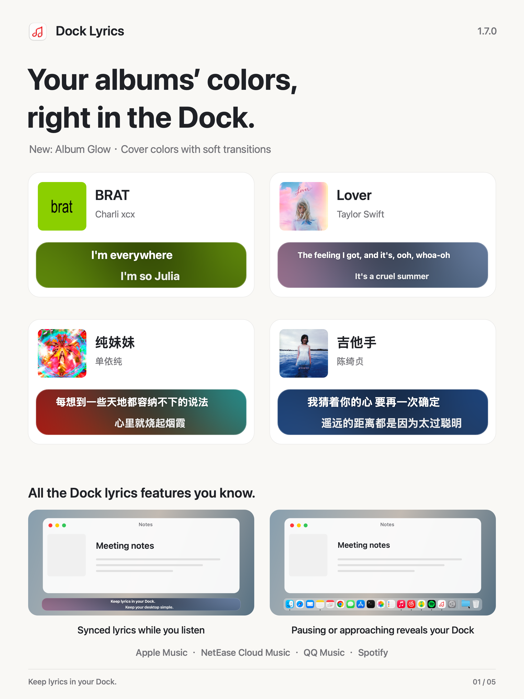
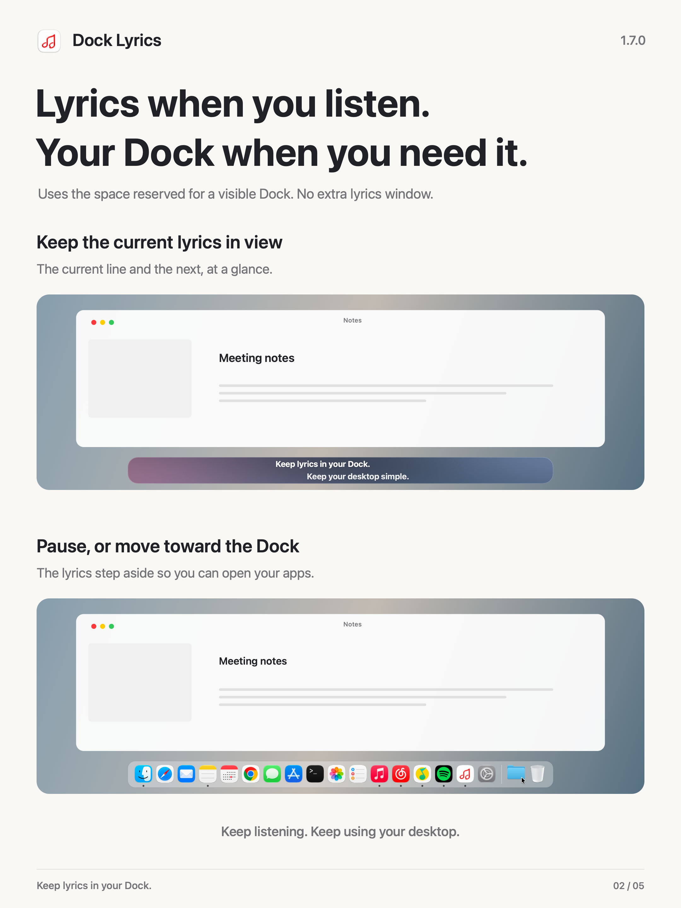
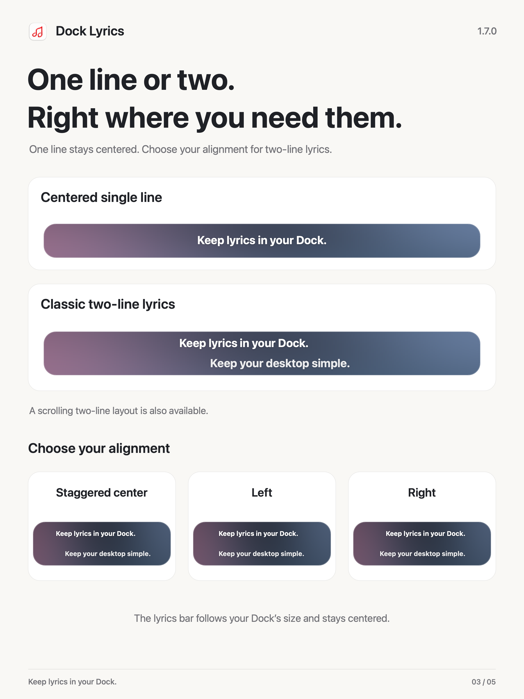
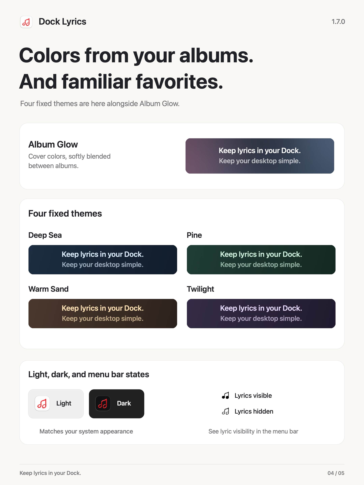
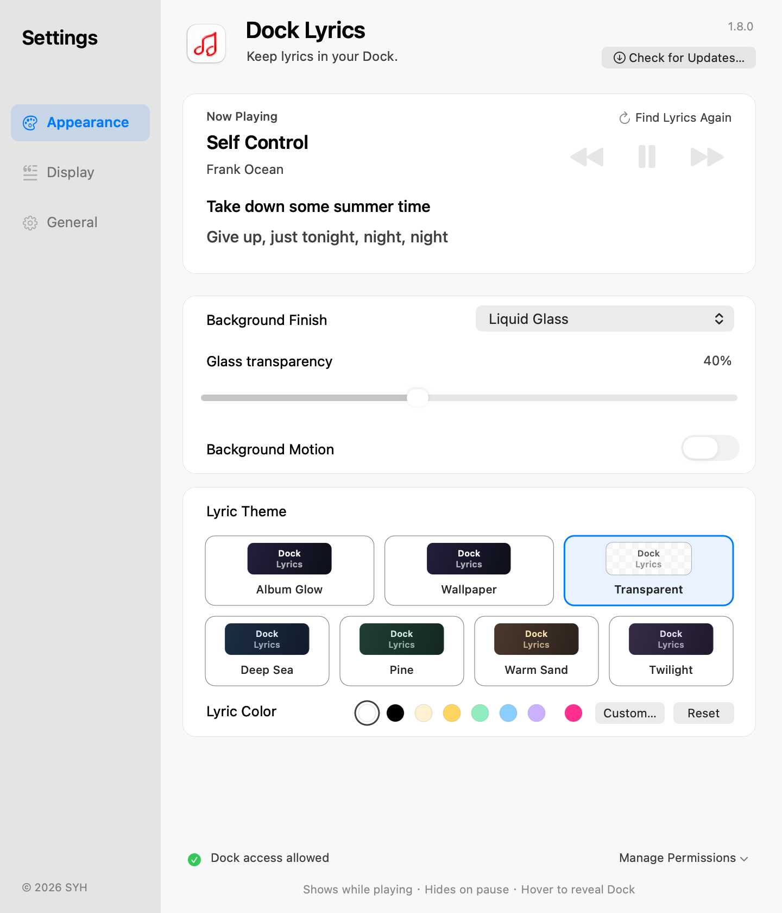
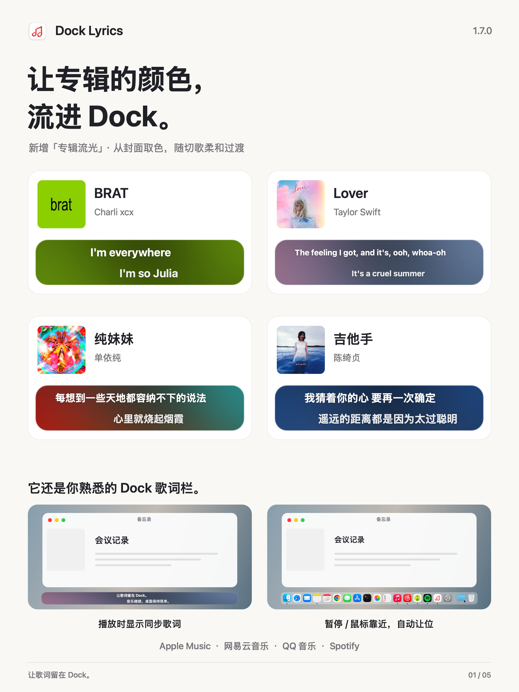
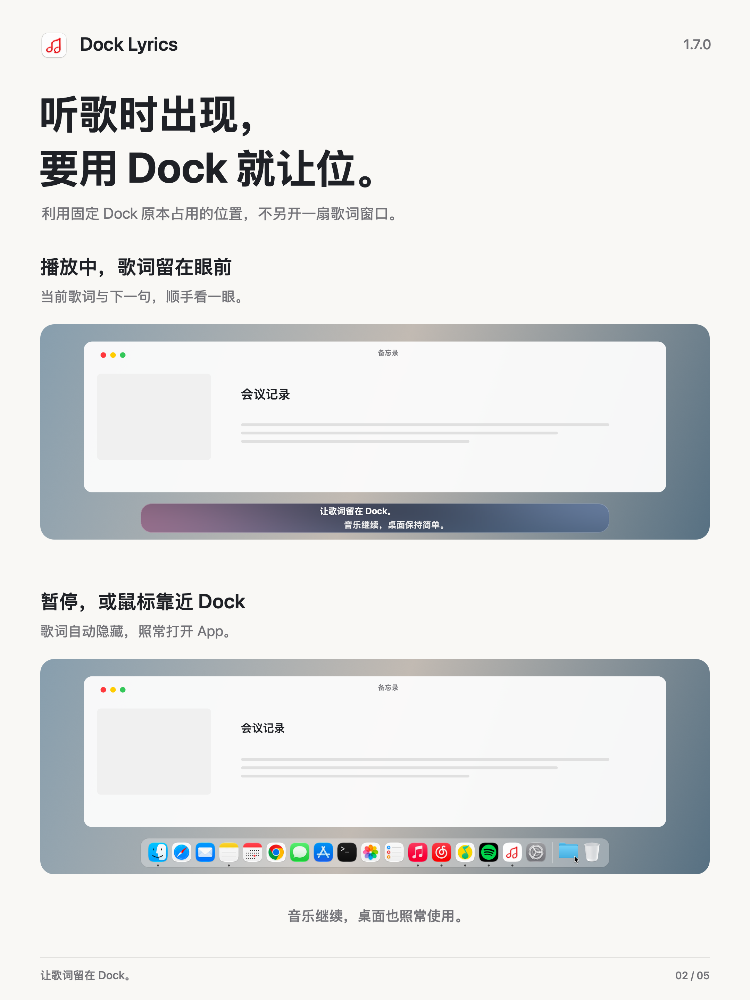
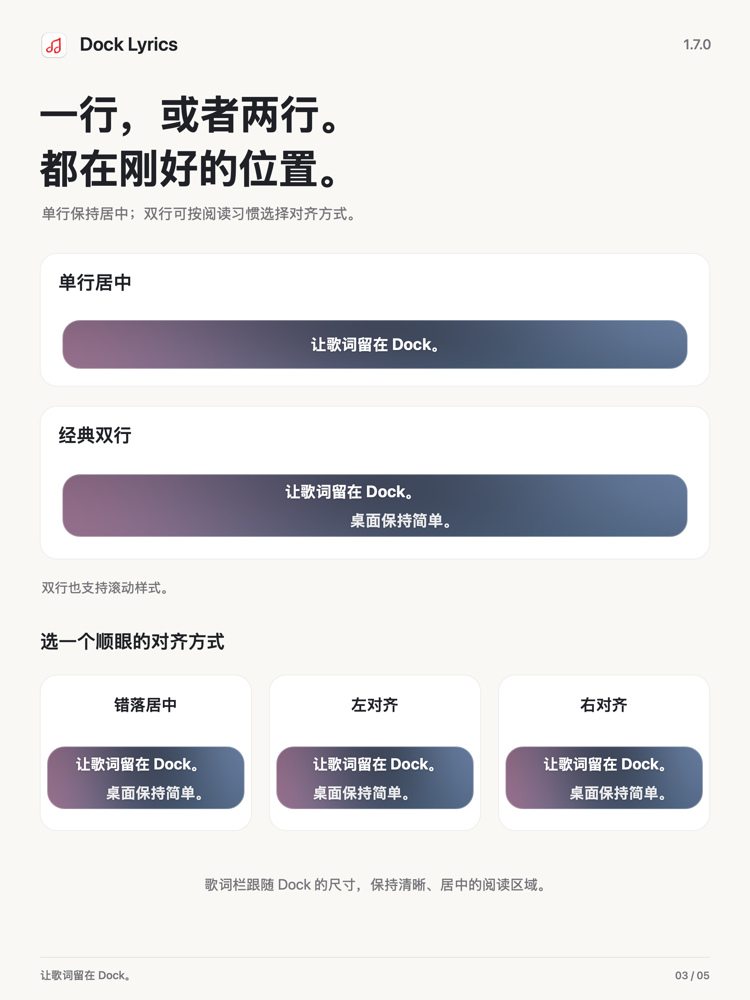
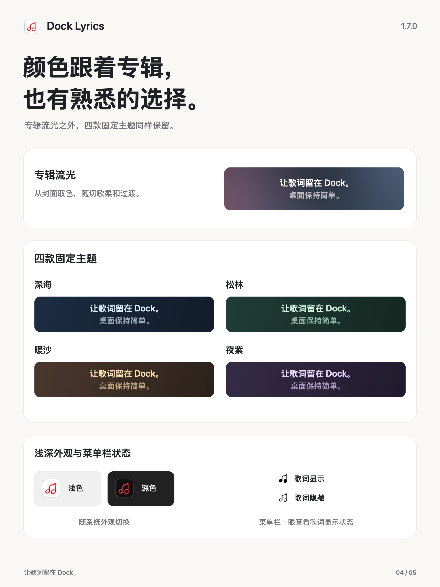
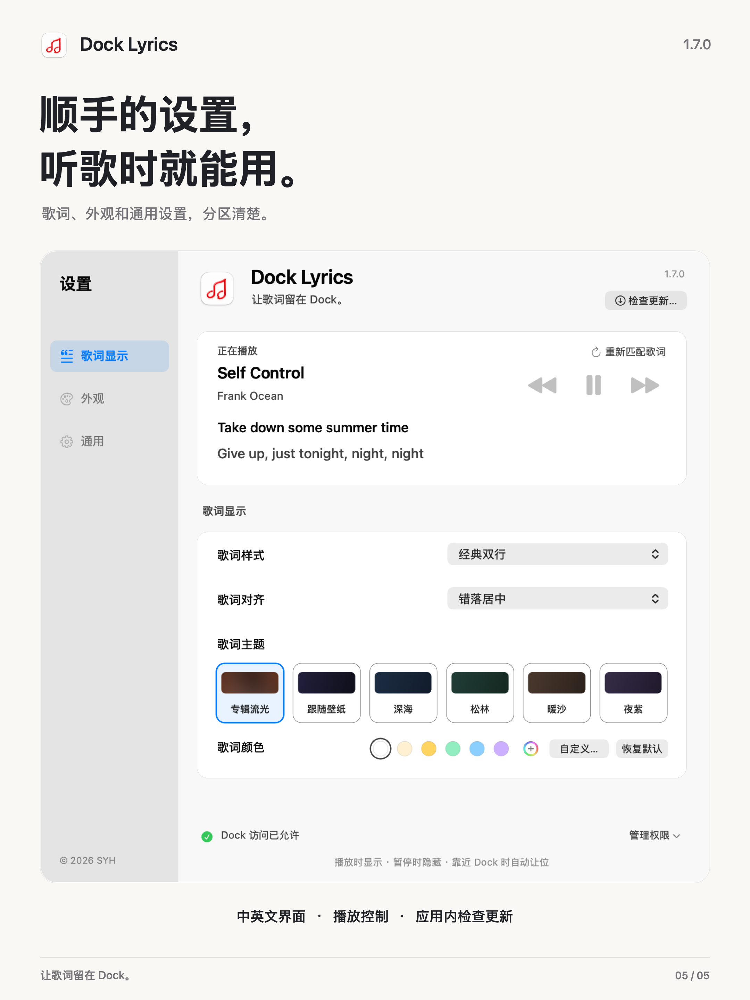

# Dock Lyrics

**Keep lyrics in your Dock. / 让歌词留在 Dock。**

**1.8.0 · Glass & Motion / 玻璃与流动**

[English](#english) · [简体中文](#简体中文) · [Download](https://github.com/syh1027/Dock-Lyrics/releases/latest) · [Issues](https://github.com/syh1027/Dock-Lyrics/issues)

## English

Dock Lyrics displays synced lyrics in the space already reserved for your Mac’s Dock. Keep up with a song while working or browsing, without leaving a music player’s lyrics window open.

### New in 1.8.0

- Adds background motion with independently moving, softly blended colors.
- Adds frosted glass and Liquid Glass, with adjustable glass transparency across all seven themes.
- Adds a Transparent theme that removes theme colors while keeping the selected glass finish.
- Adds custom lyric colors for Album Glow and Transparent, including a new black preset.
- Refreshes Settings with two rows of theme previews and clearer spacing.
- Fixes Apple Music lyric timing/display issues and NetEase Cloud Music synchronization precision.

Liquid Glass requires macOS 26 or later; frosted glass is available on earlier supported systems.

### Album Glow

Let the current album set the mood. **Album Glow** draws colors from the cover and blends them into a soft lyric background. Switching albums transitions directly from one palette to the next, with no flash back to the wallpaper color.

The current song comes first: lyric loading and album artwork run independently, while any queue preloading waits behind the song you are listening to.

### Your Dock stays within reach

Lyrics appear while music is playing. Pause, or move the pointer toward the Dock, and the bar steps aside so you can open your apps as usual.

- **Apple Music, NetEase Cloud Music, QQ Music, and Spotify.** NetEase and QQ Music support both Mac App Store and website editions.
- **Follows your Dock’s size and display.** The lyric bar stays with the visible Dock when it moves between your Mac’s screen and an external display.
- **Synced lyrics from available sources.** Uses local lyric data and online sources including NetEase Cloud Music, QQ Music, and LRCLIB. Online lookups do not require those players to be installed.
- **Better first-song handling.** This release improves Apple Music’s local lyric reading, including lyrics stored in its local database, and avoids unnecessary waiting between lyrics and album colors.
- **Clearer instrumental states.** Confirmed instrumental tracks have a dedicated message; missing lyrics are not automatically treated as instrumental music.

### One line or two

Choose a centered single line, classic two-line lyrics, or scrolling two-line lyrics. Two-line layouts support staggered center, left, and right alignment, with the lyric block kept centered over the Dock.

### Colors that fit your desktop

Choose **Album Glow**, match your wallpaper, use **Transparent**, or pick one of four coordinated themes: **Deep Sea, Pine, Warm Sand, and Twilight**. Settings shows the background colors before you choose.

Album Glow, Wallpaper, and Transparent support preset lyric colors and the native color picker, including pure white and black. Your last custom color is saved separately. All seven themes work with frosted glass or Liquid Glass and adjustable glass transparency. App icons follow the system’s light or dark appearance; the menu bar icon shows whether lyrics are visible.

### Settings, without interrupting the music

A resizable Settings window separates **Appearance, Display, and General**. Preview the current lyrics, skip tracks, play or pause, adjust the system Dock size, choose a language, and check for updates.

The app follows your system language on first launch: Chinese system languages use Simplified Chinese; other languages use English. You can choose either language manually. Song titles and lyrics retain their original language, and Japanese lyrics keep their original characters when Chinese lyrics are simplified.

### Download and updates

[Download Dock Lyrics](https://github.com/syh1027/Dock-Lyrics/releases/latest).

- **macOS 13 or later.** Universal build for Apple Silicon and Intel. Intel binaries are included and checked under Rosetta, but have not been tested on a physical Intel Mac.
- **Already using 1.4.1 or later?** Choose **Check for Updates…** in the app. When automatic checks are enabled, the app also checks at launch and periodically while running. If an update is found, the settings action changes to an update reminder.
- Updates are hosted on GitHub. If a check or download fails, retry on a network that can reach GitHub. An installer downloaded elsewhere uses the same in-app update service.

Open the DMG, drag Dock Lyrics into Applications, and follow the first-launch permission prompts. Enable online lyrics in Settings to supplement missing local lyrics. The independently distributed app is not currently notarized by Apple; macOS may require approval in **System Settings → Privacy & Security** on first launch.

Dock Lyrics is designed for a **visible Dock at the bottom of the screen**. Lyrics depend on track metadata and source availability. Upcoming-song preloading depends on player and queue access; Spotify queue preloading is not supported.

### Feedback

Report bugs or suggestions in [Issues](https://github.com/syh1027/Dock-Lyrics/issues), in English or Chinese. Include your macOS version, Dock Lyrics version, player, and steps to reproduce. For lyric matching, include the song title and artist. Please leave out account credentials and personal information.

This repository contains product information and compiled releases. The application source code is not public. Dock Lyrics is an independent project and is not affiliated with Apple, NetEase, Tencent, or Spotify.

---

## 简体中文

Dock Lyrics 利用 Mac 底部 Dock 原本占用的位置显示同步歌词。工作或浏览网页时，也能跟上音乐，无需一直打开播放器的歌词窗口。

### 1.8.0 更新

- 加入背景动效，让色彩自然流动与交融
- 加入毛玻璃与液态玻璃，七个主题均可搭配并调整玻璃透明度
- 加入透明主题，去掉主题底色，保留所选玻璃效果
- 加入专辑流光与透明主题的自定义歌词颜色，新增纯黑色预设
- 优化设置布局，主题改为两行展示，并调整控件间距
- 修复部分 Apple Music 歌词显示与时间信息更新问题
- 修复网易云音乐歌词同步精度问题

液态玻璃需要 macOS 26 或更新版本；较早的受支持系统可使用毛玻璃。

### 专辑流光

**让专辑的颜色流进 Dock。**「专辑流光」从正在播放的专辑封面中提取色彩，形成柔和的歌词背景。切换专辑时，直接从上一张专辑的颜色过渡到下一张，不再闪回壁纸颜色。

优先加载当前歌曲：歌词与专辑封面独立读取，后续歌曲的预加载排在当前歌曲之后。

### 听歌时出现，要用 Dock 就让位

音乐播放时显示歌词；暂停或鼠标靠近 Dock 时，歌词自动隐藏，照常打开应用。

- **支持 Apple Music、网易云音乐、QQ 音乐和 Spotify。** 网易云音乐与 QQ 音乐同时支持 Mac App Store 版和官网版。
- **跟随 Dock 尺寸与所在屏幕。** Dock 在 Mac 屏幕与外接显示器之间移动时，歌词栏随之跟随。
- **自动补充同步歌词。** 使用可用的本机歌词，以及网易云音乐、QQ 音乐、LRCLIB 等在线来源；在线查词无需安装对应播放器。
- **改善第一首歌的加载。** 本次改进 Apple Music 本机歌词读取，补充数据库中存储的歌词数据，减少歌词与专辑背景之间不必要的等待。
- **更清楚的纯音乐提示。** 已确认的纯音乐显示专门提示；没有查到歌词，不会直接判定为纯音乐。

### 一行或两行，都在刚好的位置

支持居中的单行、经典双行与滚动双行。双行可以选择错落居中、左对齐或右对齐，歌词整体保持在 Dock 中央。

### 选择适合桌面的颜色

第一行提供「专辑流光」「跟随壁纸」「透明」，第二行提供**深海、松林、暖沙、夜紫**四款固定主题。设置中可直接预览背景颜色。

专辑流光、跟随壁纸与透明主题均可使用预设歌词颜色或系统调色盘，包含纯白与纯黑。上一次自定义颜色会单独保存。七个主题都能搭配毛玻璃或液态玻璃，并调整玻璃透明度；应用图标随系统浅深外观切换，菜单栏图标显示歌词是否可见。

### 听歌时，设置也顺手

设置分为**外观、显示、通用**，窗口可调整大小。查看当前歌词，上一首、暂停、下一首，调整系统 Dock 大小，切换语言或检查更新，都可以在这里完成。

首次启动默认跟随系统语言：简体或繁体中文系统统一使用简体中文，其他系统语言使用英文，也可手动选择。歌名与歌词保留原文；中文歌词转为简体时，日文歌词保留原有文字。

### 下载与更新

[下载 Dock Lyrics](https://github.com/syh1027/Dock-Lyrics/releases/latest)。

- **要求 macOS 13 或更新版本。** 通用版包含 Apple Silicon 与 Intel 程序；Intel 程序经过 Rosetta 检查，尚未在实体 Intel Mac 上测试。
- **已安装 1.4.1 或更新版本的用户**，可直接在应用内点击「检查更新…」。开启自动检查后，应用会在启动和运行期间定期检查；发现新版时，设置中的按钮会变为更直观的更新提醒。
- 更新文件托管于 GitHub。若检查或下载失败，请在能够连接 GitHub 的网络环境下重试。从其他网站下载安装包，不会改变应用内更新地址。

打开 DMG，将 Dock Lyrics 拖入 Applications，首次运行时按照提示授予权限。可在设置中开启在线歌词，补充缺失的本机歌词。应用通过独立渠道分发，目前尚未获得 Apple 公证；首次运行可能需要在**系统设置 → 隐私与安全性**中允许打开。

目前主要面向**屏幕底部、保持显示的 Dock**。歌词取决于曲目信息与来源；下一首预加载取决于播放器和队列访问条件，目前不支持 Spotify 队列预加载。

### 反馈

通过 [Issues](https://github.com/syh1027/Dock-Lyrics/issues) 提交问题或建议，中英文均可。请附上 macOS 版本、Dock Lyrics 版本、播放器与复现步骤；歌词匹配问题请补充歌名及歌手。请勿附上个人信息或账号凭证。

此仓库提供产品介绍与编译后的安装包，应用源码暂不公开。Dock Lyrics 是独立项目，与 Apple、网易、腾讯及 Spotify 没有隶属关系。

© 2026 SYH
