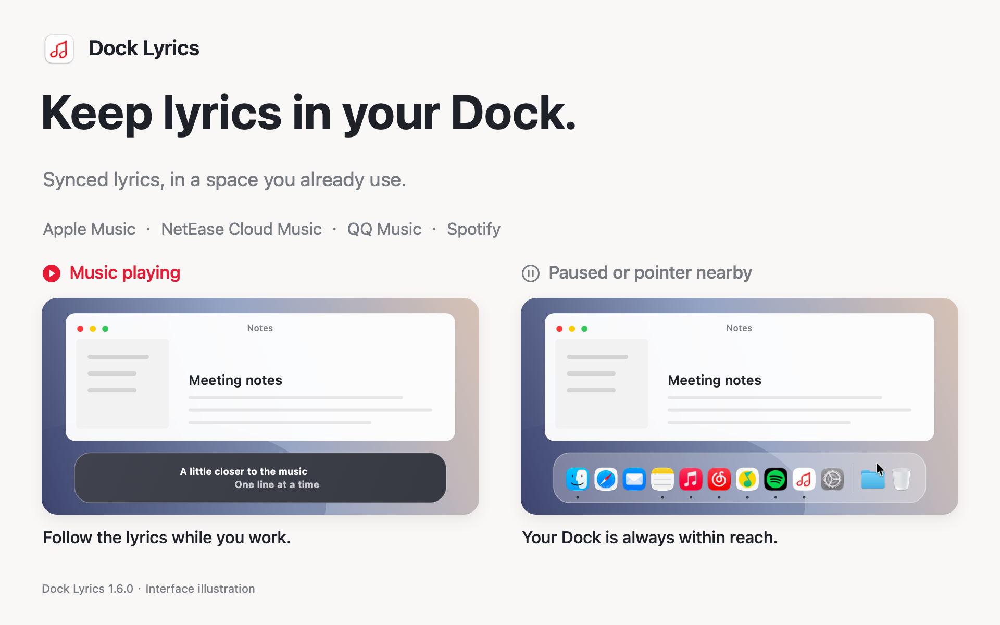
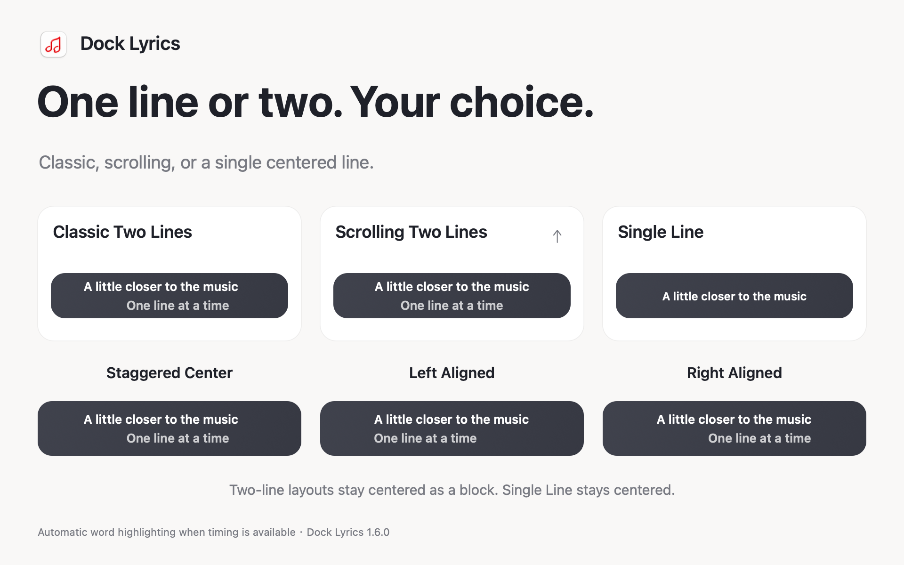
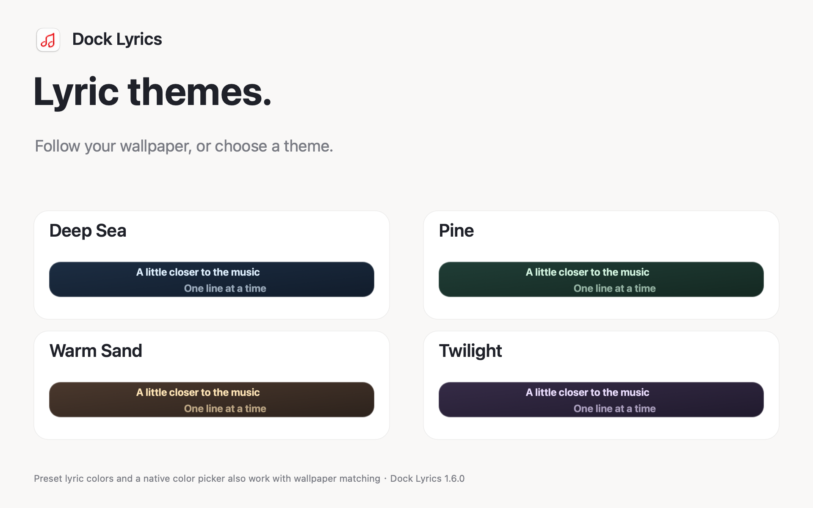
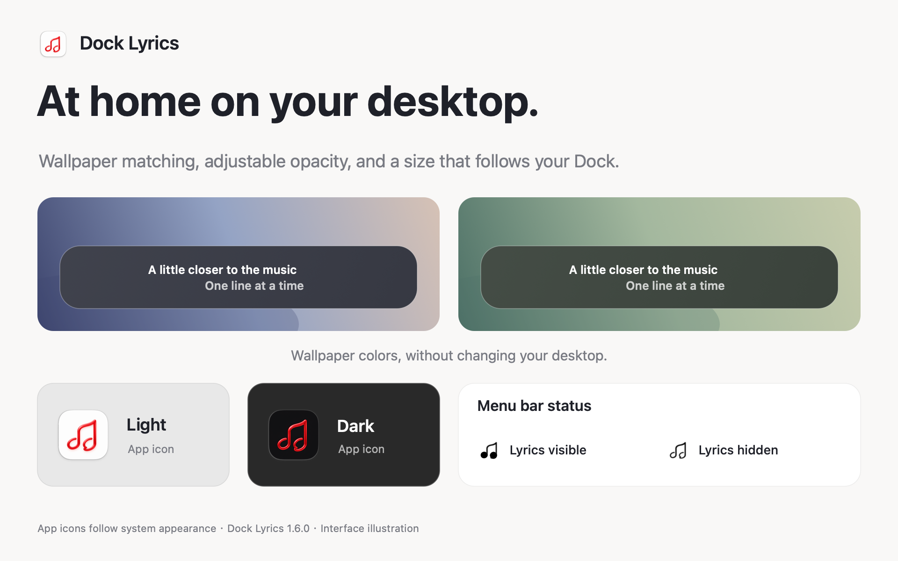
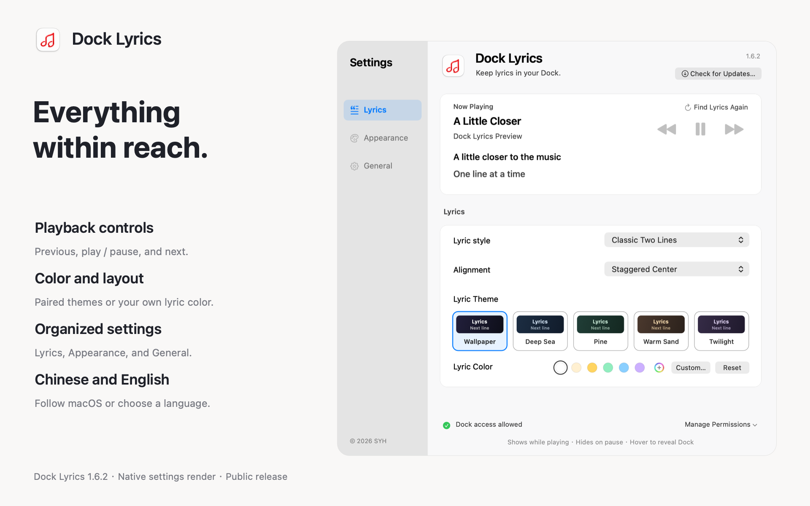

# Dock Lyrics

**Keep lyrics in your Dock.**

Latest public release: **1.6.0**

[English](#english) · [简体中文](#简体中文) · [Download](https://github.com/syh1027/Dock-Lyrics/releases/latest) · [Report an issue](https://github.com/syh1027/Dock-Lyrics/issues)

## English

Dock Lyrics puts synced lyrics over the Dock area on your Mac. Follow a song while working or browsing, without leaving a music player's lyrics window open.

It uses space already reserved for a visible Dock. Pause the music or move your pointer toward the Dock, and the lyrics step aside so your apps stay within reach.

### Features

- **Four supported players:** Apple Music, NetEase Cloud Music, QQ Music, and Spotify. NetEase and QQ Music support includes both Mac App Store and website editions.
- **Three layouts:** classic two-line lyrics, scrolling two-line lyrics, or one centered line. Two-line lyrics support staggered center, left, and right alignment while keeping the lyric block centered over the Dock.
- **Smooth word highlighting:** when a source provides word timing, the highlight moves smoothly through each word. Songs without word timing keep ordinary line synchronization.
- **Lyrics that fit your desktop:** the bar follows your Dock's size and can match colors sampled from the lower part of your wallpaper.
- **Lyric themes:** use wallpaper matching, or choose Deep Sea, Pine, Warm Sand, or Twilight for coordinated text and background colors. Each theme has a small preview in Settings.
- **Your own lyric color:** choose a preset or use the native color picker with wallpaper matching. Your last custom color stays saved when you switch presets or themes, and can be restored with one click. Default lyrics are white.
- **Adjustable background opacity:** keep the bar's base color and lyric brightness while changing how much shows through.
- **Playback controls:** previous, play/pause, and next are available beside the live lyric preview in Settings.
- **Organized settings:** Lyrics, Appearance, and General sections in a resizable window. You can also adjust the system Dock size from Appearance.
- **Automatic lyric matching:** uses available local lyric data and online sources, including NetEase Cloud Music, QQ Music, and LRCLIB. Online lookups do not require the corresponding players to be installed.
- **Current song first:** current lyrics take priority. Upcoming lyrics are prepared afterward when the player provides an accessible queue. Matched lyrics are cached, with limited automatic retries after a lookup failure.
- **Chinese and English:** follows your system language or a manual selection. Chinese system languages use Simplified Chinese; other system languages use English. Song titles and lyrics retain their original language.
- **In-app updates:** supported older releases can check for and install new versions from the app. Automatic checks depend on the updater's settings and access to the GitHub update service.

### One line or two

Choose a layout that suits the way you listen. Single-line lyrics stay centered; two-line layouts keep the current and upcoming lines together as a centered block.

### Make it yours

Keep wallpaper matching, or pick one of four paired lyric themes. The background and lyric color work together; presets and a native color picker remain available with wallpaper matching.

Wallpaper matching, adjustable opacity, appearance-aware app icons, and menu bar states help Dock Lyrics fit your desktop.

### Everything within reach

Preview the current lyrics, control playback, adjust the appearance, choose a language, and check for updates from the categorized Settings window.

Full-size settings: [Light](assets/settings-en-light.png) · [Dark](assets/settings-en-dark.png).

### Download and use

[Download the latest release](https://github.com/syh1027/Dock-Lyrics/releases/latest).

Users on **1.4.1, 1.5.0, or 1.5.1** can open **Check for Updates…** to upgrade directly to 1.6.0. Automatic checks can also notify you when enabled. Access to GitHub's update service is required; downloading an installer from another site does not change the update service used by the app.

The universal build includes Apple Silicon and Intel binaries and requires **macOS 13 or later**. Open the DMG, drag Dock Lyrics into Applications, and launch it there. Follow the permission prompts, then play a song in a supported player. Enable online lyrics in Settings to supplement missing local lyrics.

Dock Lyrics is designed primarily for a **visible Dock at the bottom of the screen**. Lyrics and word timing depend on track metadata and source availability. Preparing upcoming lyrics depends on the player and queue access; Spotify queue preloading is not supported. Intel binaries are included, but this release has not been tested on a physical Intel Mac.

This independently distributed app is not currently notarized by Apple. macOS may require first-launch approval in System Settings → Privacy & Security.

### Feedback and project status

Please report bugs and suggestions in [Issues](https://github.com/syh1027/Dock-Lyrics/issues). Include your macOS version, Dock Lyrics version, music player, and steps to reproduce the problem. For lyric matching issues, include the song title and artist. English and Chinese reports are welcome; leave out personal information and account credentials.

This repository contains product information and compiled releases. The application source code is not public. Dock Lyrics is an independent project and is not affiliated with Apple, NetEase, Tencent, or Spotify.

---

## 简体中文

**让歌词留在 Dock。**

最新公开版：**1.6.0**

Dock Lyrics 在 Mac 的 Dock 所在位置显示同步歌词。工作、浏览网页时，也能跟上正在播放的音乐，无需一直打开音乐软件的歌词窗口。

它利用保持显示的 Dock 已经占用的空间。音乐暂停或鼠标靠近时，歌词自动让位，方便继续点击 Dock 中的应用。

### 功能

- **四款播放器：** Apple Music、网易云音乐、QQ 音乐和 Spotify；网易云音乐与 QQ 音乐支持 Mac App Store 版和官网版。
- **三种歌词样式：** 经典双行、滚动双行，以及居中的单行歌词。双行支持错落居中、左对齐和右对齐，歌词整体始终位于 Dock 中央。
- **平滑逐字高亮：** 来源提供逐字时间数据时，高亮会在词内平滑推进；没有逐字数据的歌曲保持普通整句同步。
- **跟随桌面：** 歌词栏适应 Dock 尺寸，并可根据壁纸底部取色。
- **歌词主题：** 保留“跟随壁纸”，也可选择“深海”“松林”“暖沙”“夜紫”四种歌词与背景搭配，设置中可直接看到小图预览。
- **自定义歌词颜色：** 在跟随壁纸模式下使用预设色或原生调色盘。上一次自定义的颜色会单独保存，切换预设或主题后仍可一键找回；初始默认白色。
- **背景透明度：** 调整背景的不透明度，同时保留底色和歌词亮度。
- **播放控制：** 设置中的实时歌词预览旁提供上一首、播放／暂停和下一首。
- **分类设置：** 歌词显示、外观、通用三个分类，窗口可调整大小；外观页也提供系统 Dock 大小调整。
- **自动补充歌词：** 使用可用的本机数据，以及网易云音乐、QQ 音乐、LRCLIB 等在线来源；在线查词无需安装对应播放器。
- **优先当前歌曲：** 先加载正在播放的歌词，再根据可读取的队列准备后续歌曲。已匹配歌词会缓存，查询失败时有限次自动重试。
- **中英文界面：** 默认跟随系统，也可手动选择。中文系统语言统一显示简体中文，其他系统语言使用英文；歌名和歌词保留原文。
- **应用内更新：** 支持的旧版本可直接检查并安装新版；自动检查取决于更新组件设置，需要能够连接 GitHub 更新服务。

上方五张配图展示基本使用、歌词样式与对齐、歌词主题、桌面外观，以及新的分类设置界面。

### 下载与使用

[下载最新版本](https://github.com/syh1027/Dock-Lyrics/releases/latest)。

已安装 **1.4.1、1.5.0 或 1.5.1** 的用户，可在应用中点击“检查更新…”升级至 1.6.0。开启自动检查后，也可在检查到新版本时收到提示。需要能够连接 GitHub 更新服务；从其他网盘下载安装包，不会改变软件使用的更新地址。

通用安装包包含 Apple Silicon 与 Intel 二进制程序，要求 **macOS 13 或更新版本**。打开 DMG，将 Dock Lyrics 拖入 Applications，从应用程序文件夹启动并按照提示授予权限，再使用支持的播放器播放歌曲。如需补充缺失的本机歌词，请在设置中开启“在线歌词”。

目前主要面向**位于屏幕底部、保持显示的 Dock**。歌词和逐字时间数据取决于曲目信息及来源；下一首预加载取决于播放器与队列访问条件，目前不支持 Spotify 队列预加载。本版包含 Intel 程序，但尚未在实体 Intel Mac 上测试。

应用通过独立渠道分发，目前尚未获得 Apple 公证。首次打开时，macOS 可能要求在“系统设置 → 隐私与安全性”中允许启动。

### 反馈与项目状态

欢迎通过 [Issues](https://github.com/syh1027/Dock-Lyrics/issues) 提交问题或建议，中英文均可。请附上 macOS 版本、Dock Lyrics 版本、播放器和复现步骤；歌词匹配问题请补充歌名及歌手。请勿附上个人信息或账号凭证。

此仓库提供产品介绍与编译后的安装包，应用源码暂不公开。Dock Lyrics 是独立项目，与 Apple、网易、腾讯及 Spotify 没有隶属关系。

© 2026 SYH
