# Dock Lyrics

**Keep lyrics in your Dock. · 让歌词留在 Dock。**

[Download latest release / 下载最新版](https://github.com/syh1027/Dock-Lyrics/releases/latest) · [English](#english) · [简体中文](#简体中文) · [GitHub Issues](https://github.com/syh1027/Dock-Lyrics/issues)

## English

Dock Lyrics is a macOS app that displays synchronized lyrics in the bottom Dock. Follow the music while you work, read, or browse without keeping a player’s lyrics window open.

  <a href="assets/posters/en/01-lyrics-in-your-dock.jpg">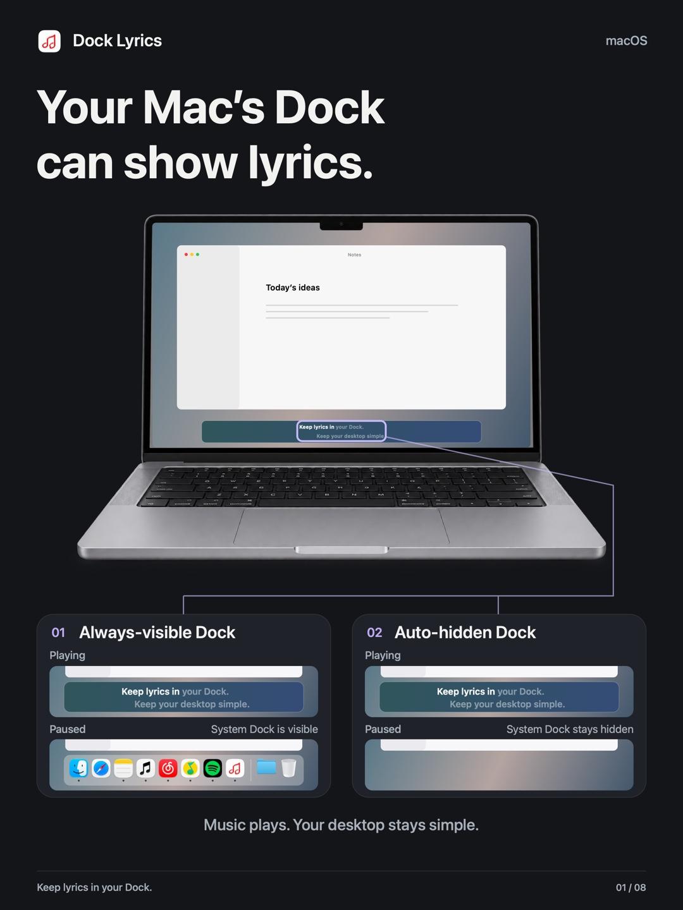</a>

### Players, lyrics, and translation

- Dock Lyrics works with **Apple Music, NetEase Cloud Music, QQ Music, and Spotify**. It supports both the Mac App Store and website editions of NetEase Cloud Music and QQ Music.
- **Synced lyrics** show the current and upcoming lines as the song plays. When the matched lyrics include word timings, the highlight advances with the words. Confirmed instrumentals have a separate status from tracks with missing lyrics.
- Dock Lyrics uses available **local lyrics** and can supplement them with **online sources**, including NetEase Cloud Music, QQ Music, KuGou, and LRCLIB. A lyric source can differ from the active player. Enable **Online lyrics** in Settings for online matching, and use **Find Lyrics Again** to retry a match.
- For **translation**, choose **Original**, **Original + Translation**, or **Translation**. Simplified Chinese translations are shown when available. Original lyrics fill gaps when no translation is available. Optional **System translation** uses Apple’s on-device translation on macOS 15 or later and requires the relevant language packs. Coverage depends on the track, lyric source, and language.

<table>
  <tr>
    <td width="50%"><a href="assets/posters/en/08-supported-players.jpg">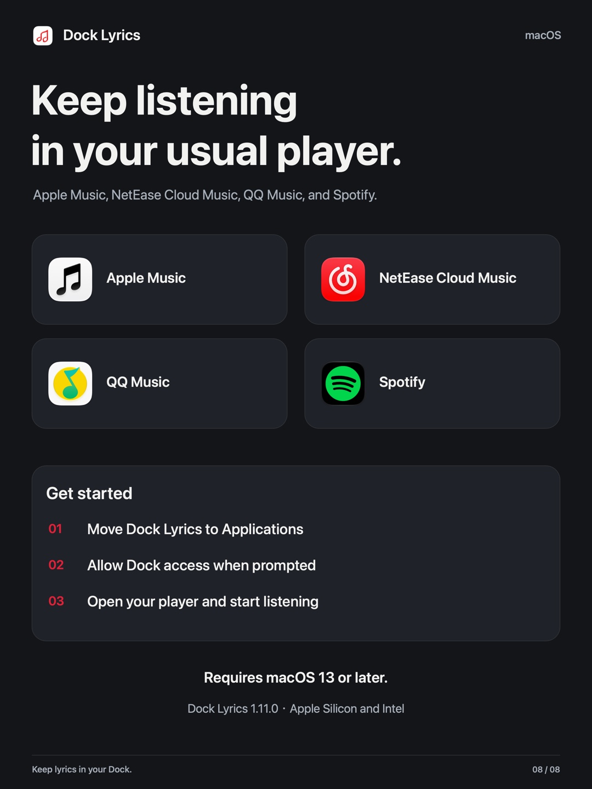</a></td>
    <td width="50%"><a href="assets/posters/en/07-lyrics-and-translation.jpg">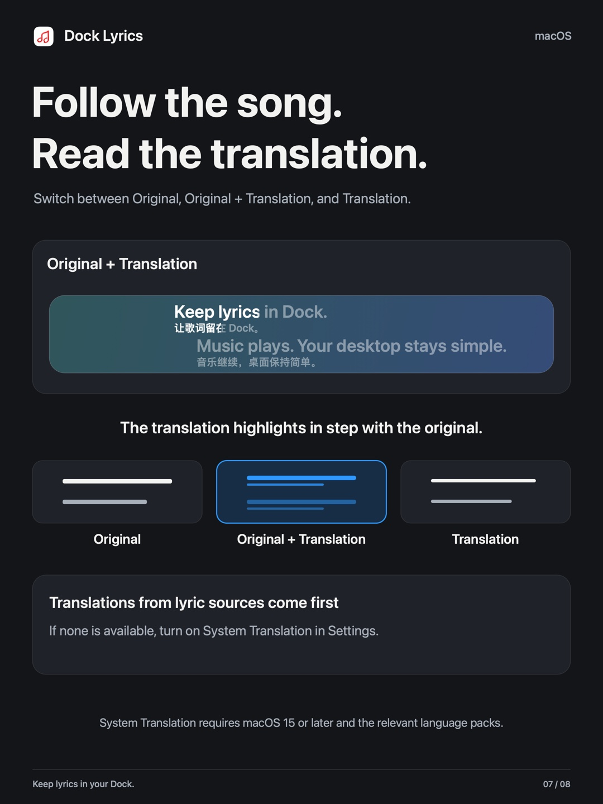</a></td>
  </tr>
</table>

### Dock behavior and controls

The lyric bar appears during playback and steps aside when you pause or approach the Dock. It supports both an always-visible and an automatically hidden **bottom Dock**. With auto-hide on, the bar fades out to let the system Dock open and returns after the Dock closes if lyrics are enabled. The bar adapts to the Dock’s size and follows its display, including external monitors.

Use the menu bar icon for Settings, lyric visibility, and rematching. Right-click the Dock Lyrics icon in the Dock for those same three actions. Settings also lets you pin a control to the menu bar menu for playback, lyric sync, Dock size, or glass transparency.

  <a href="assets/posters/en/02-dock-behavior.jpg">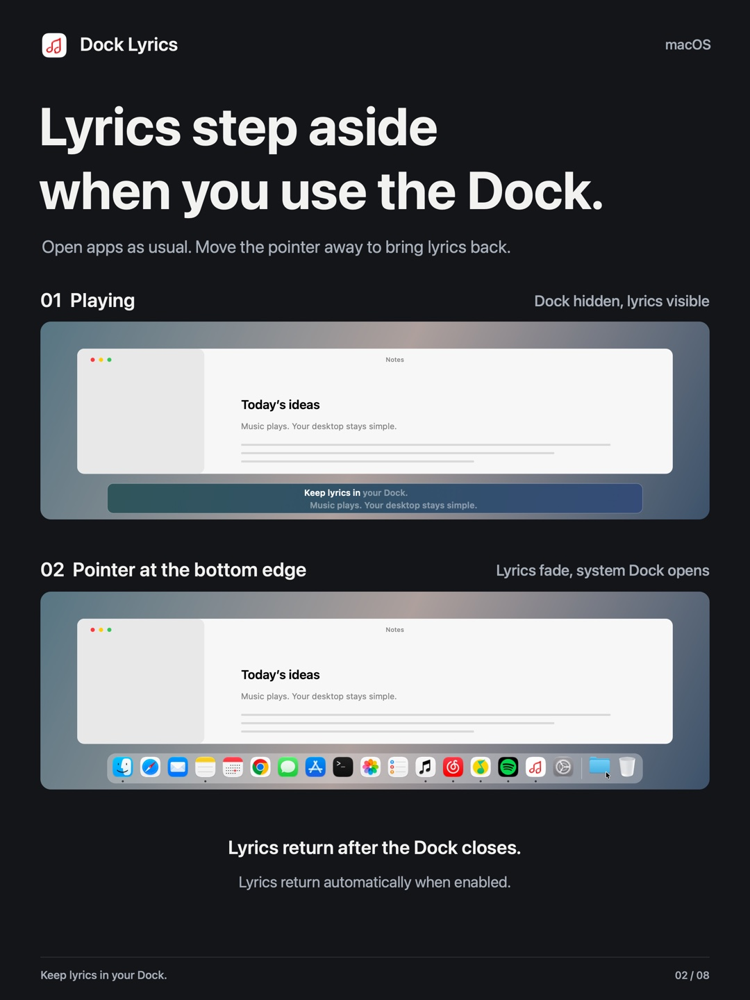</a>

### Appearance, layout, and Settings

- Under **Appearance**, choose Album Glow, Match Wallpaper, Transparent, or one of four fixed themes. Album Glow takes its colors from the current cover. Customize the glass transparency, background motion, and supported lyric colors, or choose a different app icon. Liquid Glass requires macOS 26 or later. Frosted glass is available on earlier supported versions.
- Choose a **layout** with a centered single line, classic two-line lyrics, or scrolling two-line lyrics. Two-line layouts offer staggered center, left, and right alignment. Choose a lyric font, adjust the single-line text size, and set translation alignment separately when showing both languages.
- **Settings** has three tabs, Appearance, Display, and General. They bring together a live preview, playback controls, lyric sync adjustment, system Dock size, launch at login, and updates. The interface can follow the system language or be set to English or Simplified Chinese.

<table>
  <tr>
    <td width="50%"><a href="assets/posters/en/03-album-glow.jpg">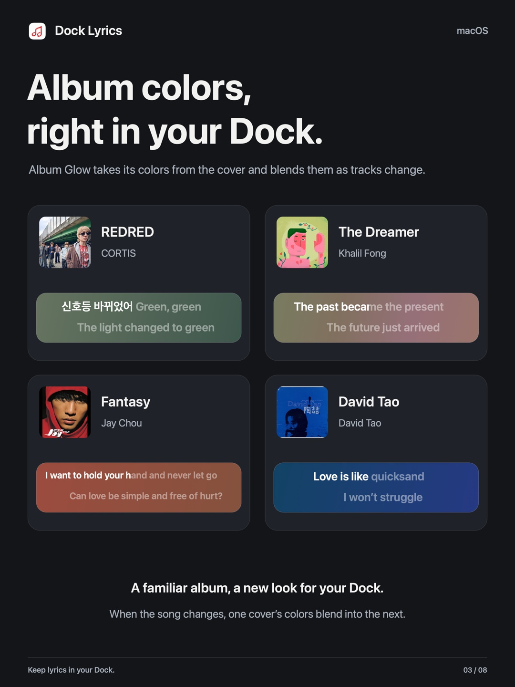</a></td>
    <td width="50%"><a href="assets/posters/en/04-background-motion.jpg">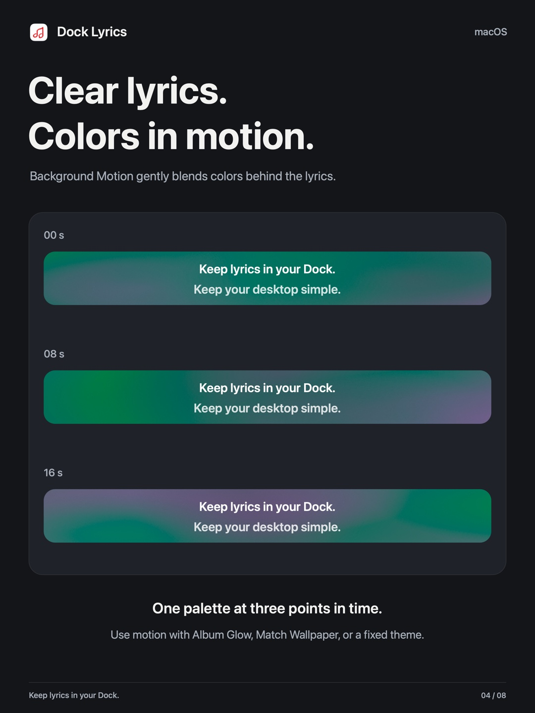</a></td>
  </tr>
</table>

<table>
  <tr>
    <td width="50%"><a href="assets/posters/en/05-appearance-and-icons.jpg">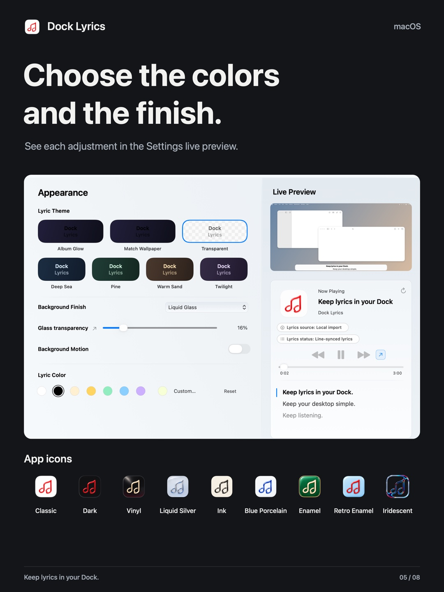</a></td>
    <td width="50%"><a href="assets/posters/en/06-lyric-layouts.jpg">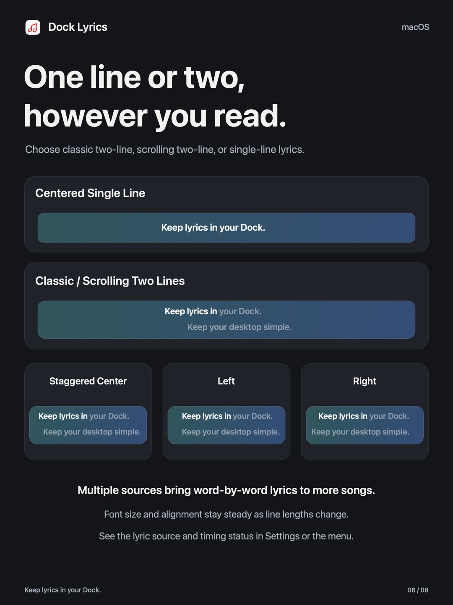</a></td>
  </tr>
</table>

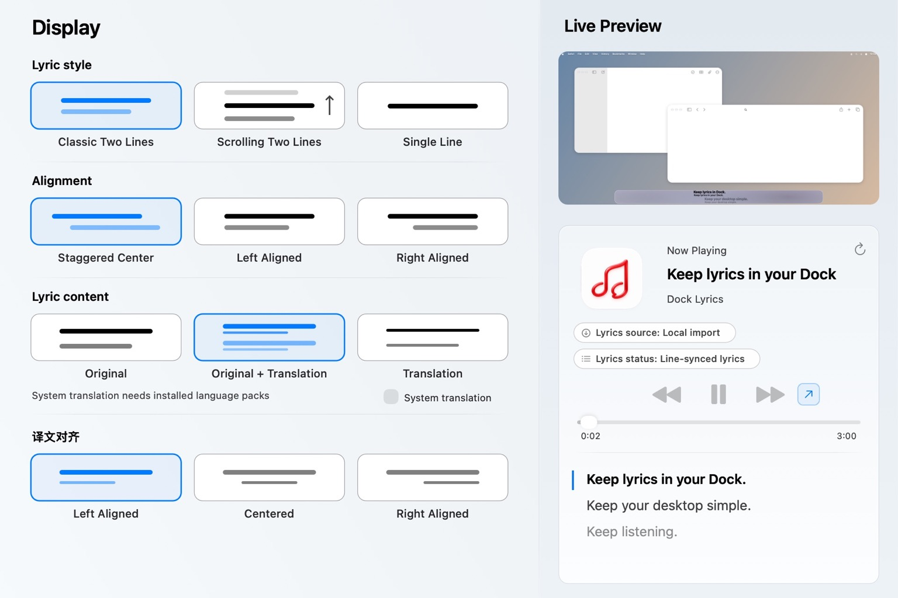

### Download and install

**Requires macOS 13 or later.** The universal build supports Apple Silicon and Intel Macs.

1. Download the `.dmg` under **Assets** on the [latest GitHub release](https://github.com/syh1027/Dock-Lyrics/releases/latest).
2. Open the disk image, drag **Dock Lyrics** into **Applications**, and launch it from there.
3. Follow the first-launch prompts. In **System Settings → Privacy & Security → Accessibility**, allow Dock Lyrics to read the Dock’s position. Keep the system Dock at the bottom of the screen.
4. Start playing a track in a supported player. Open Dock Lyrics Settings from the menu bar to adjust the display or enable online lyric matching.

To update an installed copy, choose **Check for Updates…** in Settings or download the latest DMG.

### Feedback

Report a bug or suggest an improvement in [GitHub Issues](https://github.com/syh1027/Dock-Lyrics/issues). Include your macOS and Dock Lyrics versions, the player, and steps to reproduce. For lyric issues, add the song title and artist. Please leave out credentials and other private information.

Dock Lyrics is independently developed. This repository hosts product information and downloads. Dock Lyrics has no affiliation with Apple, NetEase, Tencent, or Spotify.

---

## 简体中文

Dock Lyrics 是一款在 Mac 底部程序坞显示同步歌词的应用。工作、阅读或浏览网页时，都能跟上音乐，无需一直打开播放器的歌词窗口。

  <a href="assets/posters/zh-Hans/01-lyrics-in-your-dock.jpg">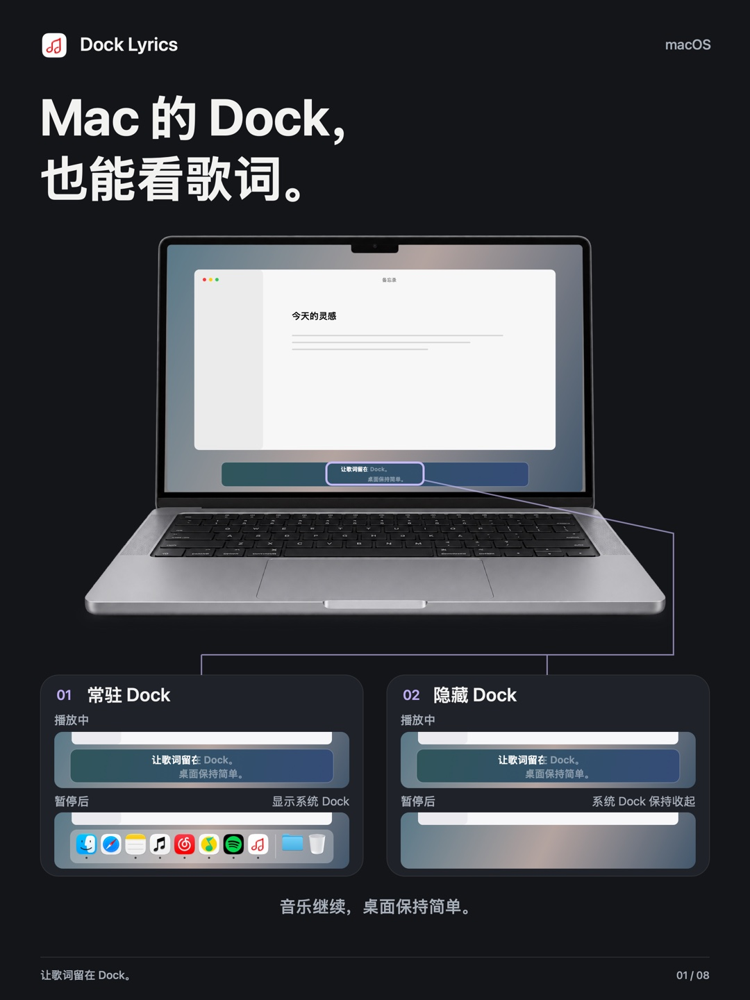</a>

### 播放器、歌词与翻译

- **支持的播放器**包括 Apple Music、网易云音乐、QQ 音乐和 Spotify。网易云音乐与 QQ 音乐均支持 Mac App Store 版和官网版。
- **同步歌词**随播放进度显示当前句和下一句。匹配到逐字时间轴时，歌词会随演唱逐字高亮。已确认的纯音乐有独立提示，与未匹配到歌词区分显示。
- **歌词来源**包括可用的本机歌词，也可从网易云音乐、QQ 音乐、酷狗音乐、LRCLIB 等在线来源补充。歌词来源可以与当前播放器不同。开启设置中的「在线歌词」即可查找在线歌词，也可用「重新匹配歌词」重试。
- **翻译**支持「原文」「原文＋译文」和「译文」三种模式。有简体中文译文时可显示，缺少译文的行会回退到原文。可选的「系统翻译补全」使用 macOS 15 或更新版本的 Apple 本机翻译，需要安装相应语言包。覆盖范围取决于歌曲版本、歌词来源和语言。

<table>
  <tr>
    <td width="50%"><a href="assets/posters/zh-Hans/08-supported-players.jpg">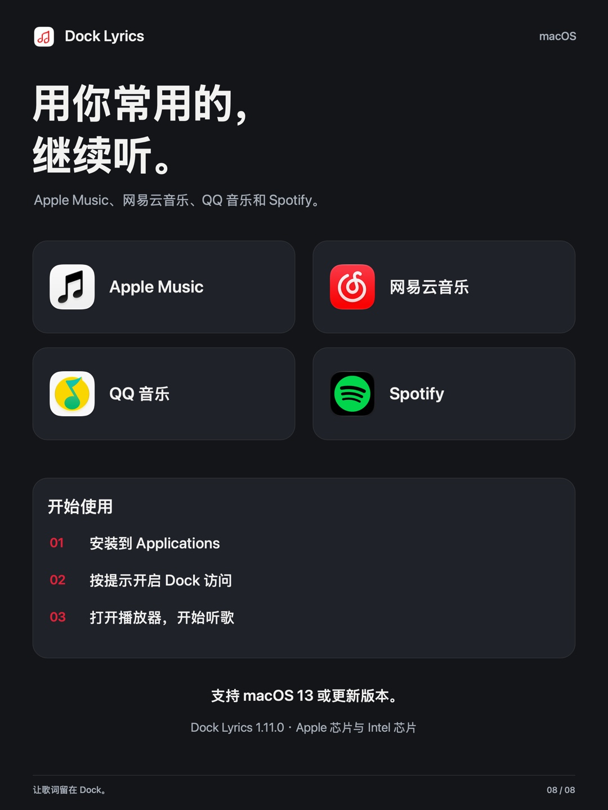</a></td>
    <td width="50%"><a href="assets/posters/zh-Hans/07-lyrics-and-translation.jpg">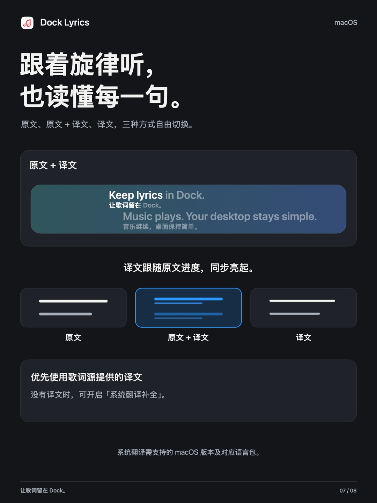</a></td>
  </tr>
</table>

### Dock 交互与操作

播放时显示歌词，暂停或鼠标靠近时自动让位。支持常驻和自动隐藏两种**底部 Dock**。开启自动隐藏时，歌词栏会淡出，让系统 Dock 正常展开。Dock 收起后，若歌词开关已开启，歌词会恢复显示。歌词栏随 Dock 尺寸调整，也会跟随 Dock 移动到外接显示器。

可从菜单栏图标打开设置、显示或隐藏歌词、重新匹配歌词。右键点击系统 Dock 中的 Dock Lyrics 图标也可以进行这三项操作。还可以在设置中选择把播放控制、歌词同步、Dock 大小或玻璃透明度中的一项固定到菜单栏菜单。

  <a href="assets/posters/zh-Hans/02-dock-behavior.jpg">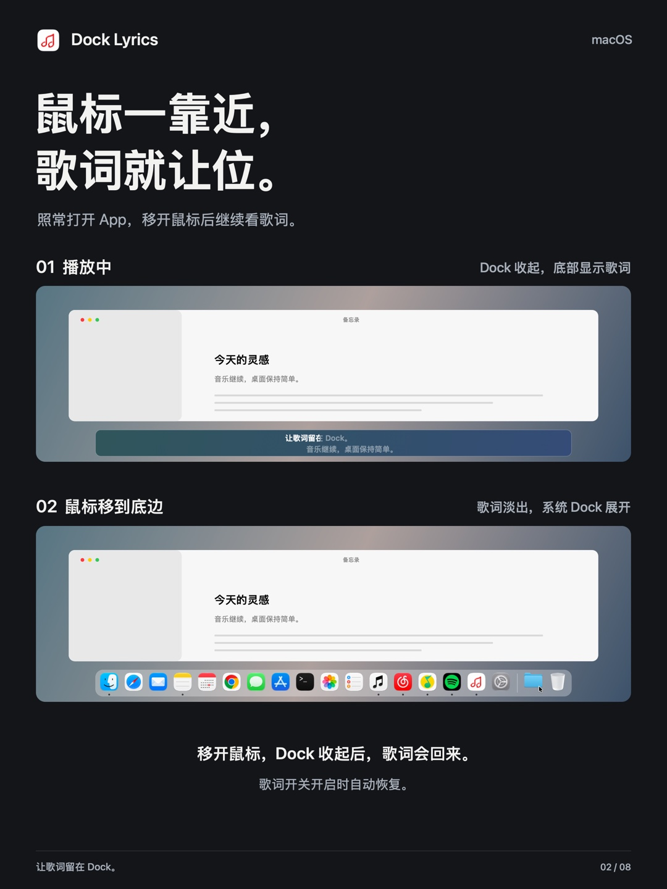</a>

### 外观、布局与设置

- **外观**可选专辑流光、跟随壁纸、透明或四种固定主题。专辑流光取色自当前封面。可调整玻璃透明度和背景动效，在支持的主题中自定义歌词颜色，也可以更换应用图标。液态玻璃需要 macOS 26 或更新版本，较早的受支持系统可使用毛玻璃。
- **布局**支持居中单行、经典双行和滚动双行。双行可选错落居中、左对齐或右对齐。可以更换歌词字体、调整单行字号，也可以在显示双语时单独设置译文对齐方式。
- **设置**分为外观、显示和通用，提供实时预览、播放控制、歌词同步微调、系统 Dock 大小、开机启动及更新检查。界面可跟随系统，也可手动选用英文或简体中文。

<table>
  <tr>
    <td width="50%"><a href="assets/posters/zh-Hans/03-album-glow.jpg">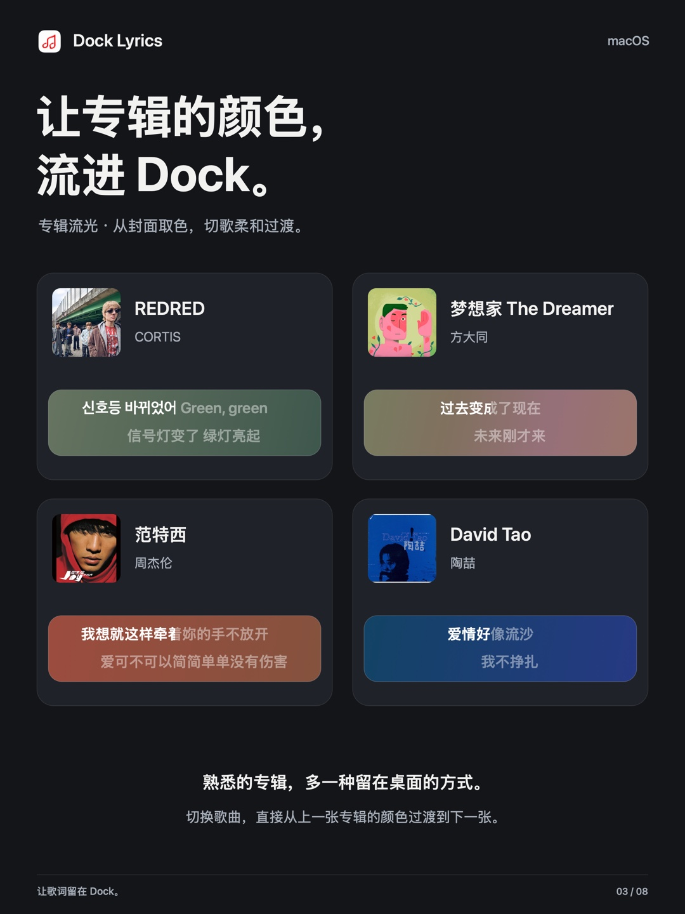</a></td>
    <td width="50%"><a href="assets/posters/zh-Hans/04-background-motion.jpg">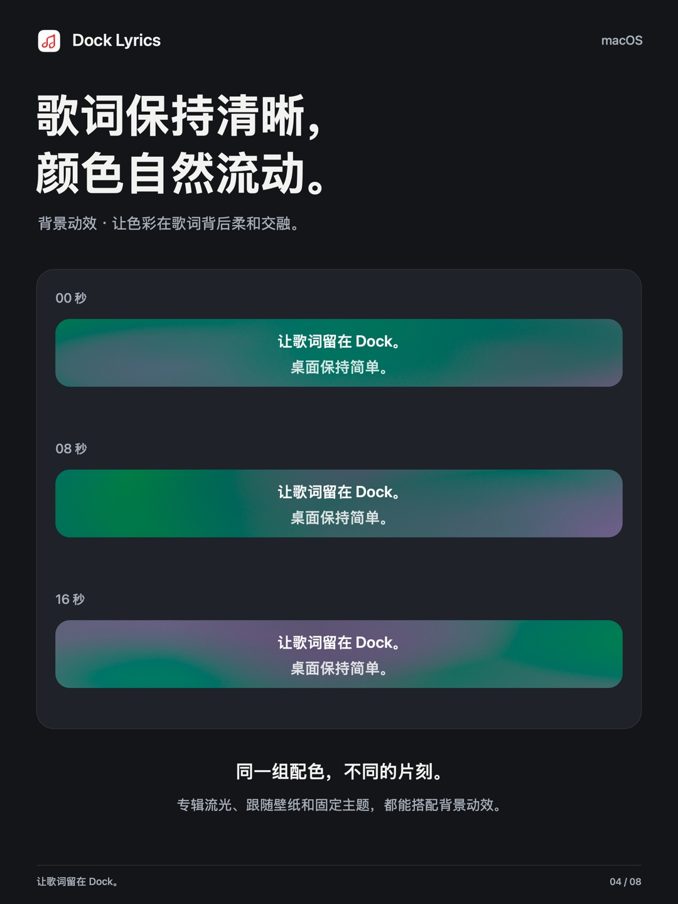</a></td>
  </tr>
</table>

<table>
  <tr>
    <td width="50%"><a href="assets/posters/zh-Hans/05-appearance-and-icons.jpg">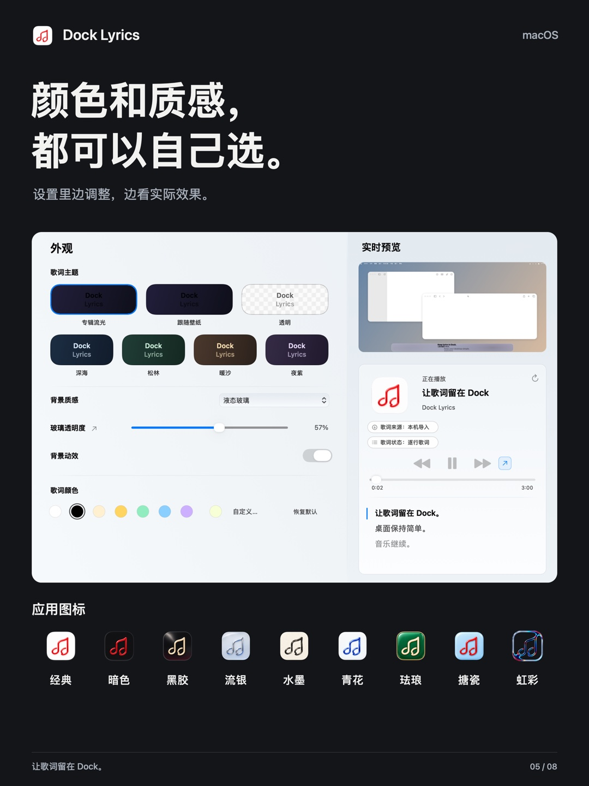</a></td>
    <td width="50%"><a href="assets/posters/zh-Hans/06-lyric-layouts.jpg">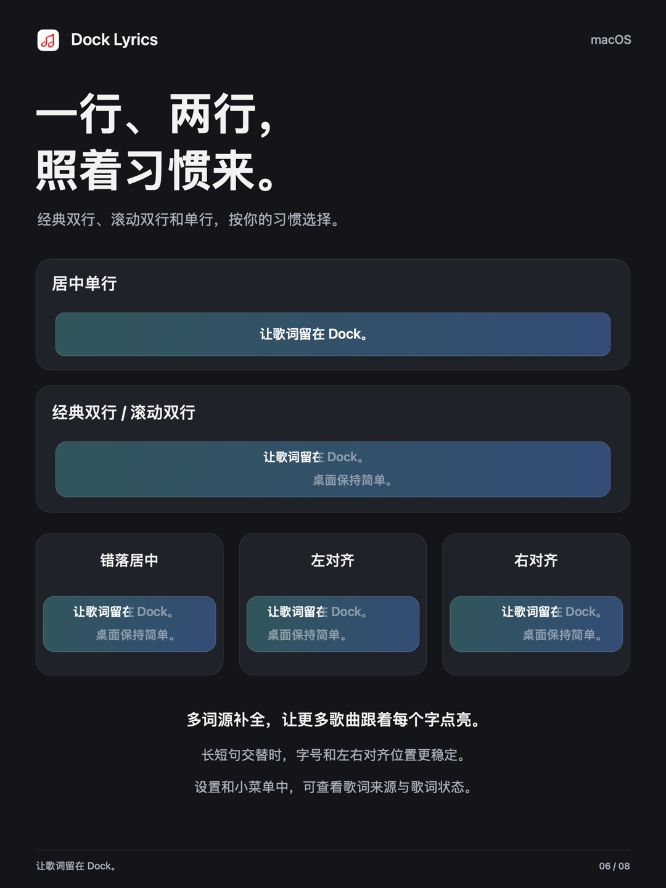</a></td>
  </tr>
</table>

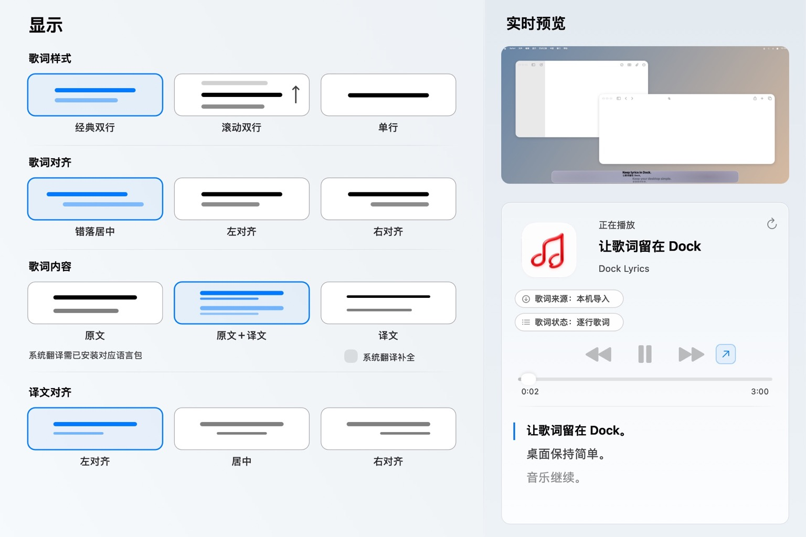

### 下载与安装

**需要 macOS 13 或更新版本。** 通用版本支持 Apple 芯片和 Intel 芯片的 Mac。

1. 打开 [GitHub 最新正式发布](https://github.com/syh1027/Dock-Lyrics/releases/latest)，从 **Assets** 下载 `.dmg`。
2. 打开磁盘映像，将 **Dock Lyrics** 拖入「应用程序」，再从该目录打开应用。
3. 按首次启动提示操作。在「系统设置 → 隐私与安全性 → 辅助功能」中授权 Dock Lyrics，以便读取 Dock 位置。请将系统 Dock 放在屏幕底部。
4. 在支持的播放器中开始播放。通过菜单栏打开 Dock Lyrics 设置，即可调整显示或开启在线歌词匹配。

已安装的用户可以在设置中选择「检查更新…」，也可以下载最新的 DMG。

### 反馈

欢迎在 [GitHub Issues](https://github.com/syh1027/Dock-Lyrics/issues) 提交问题或建议。请附上 macOS 和 Dock Lyrics 版本、播放器及复现步骤。歌词问题还请提供歌名和歌手，提交时请勿附带账号凭据或其他个人信息。

Dock Lyrics 由独立开发者制作。此仓库提供产品介绍和版本下载。Dock Lyrics 与 Apple、网易、腾讯及 Spotify 无隶属关系。
